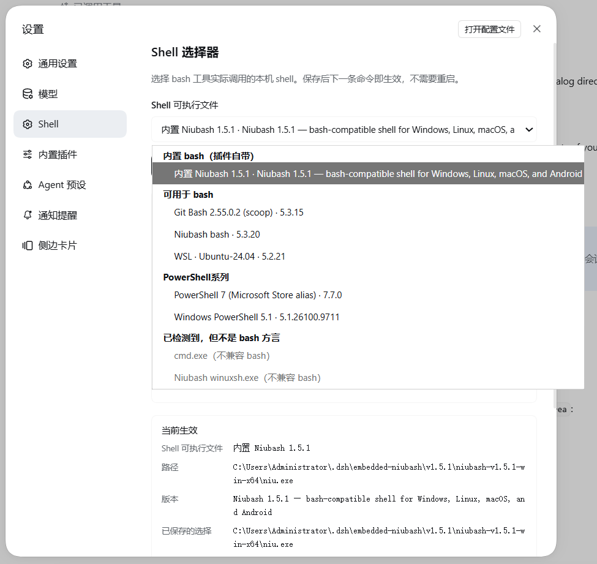
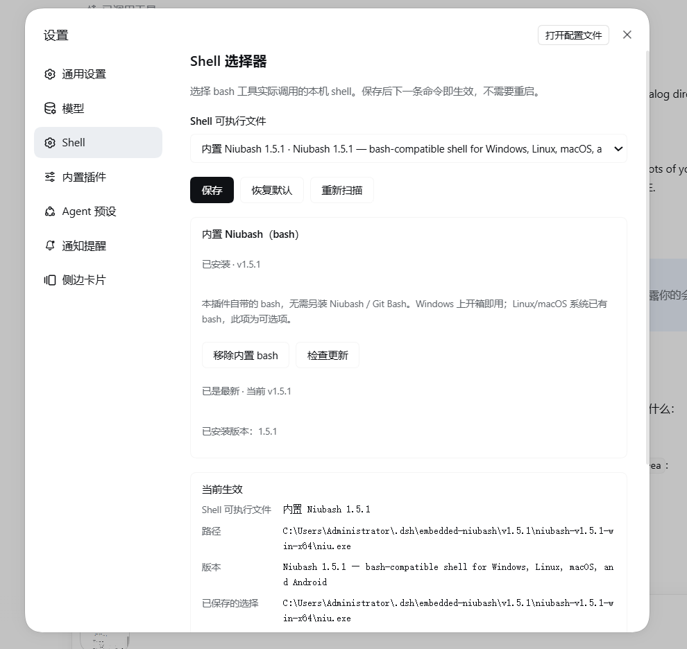
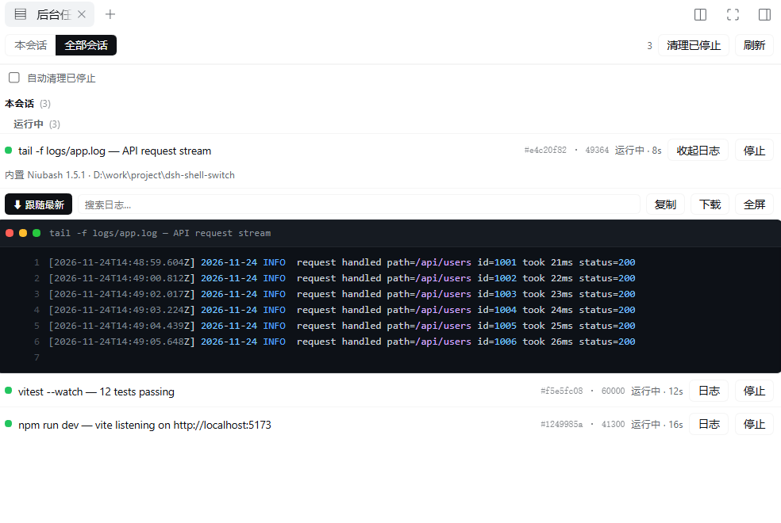

# dsh-shell-switch

[English](README.en.md) | 简体中文

给 [DeepSeek Harness](https://github.com/deepseek-ai/deepseek-harness)（DSH）加一个 **`bash` 工具**和一个 **设置 → Shell 选择器** 页面：bash 命令直接在本机真实存在的 shell（Niubash / Git Bash / MSYS2 / Cygwin / WSL / PATH 里的 `bash.exe`）里执行，插件默认启用自带的Windows开箱即用、可在线更新升级的 [Niubash](https://github.com/unixwin/niubash) bash,另外可通过扩展better-sidebar支持常驻进程、流式看日志，默认终端改为所选bash。

```
之前：模型想跑 ls → 必须写成 Get-ChildItem（pwsh 工具），或依赖其他插件自带的 MSYS bash（沙箱里经常起不来）
之后：模型跑 ls → 直接在 Niubash bash 5.3 里执行，输出、退出码、spill 与官方 bash 工具一致；常驻后台进程走插件自带的 bg_* 工具
```

## 截图

**设置 → Shell 选择器**：一个下拉框列出本机所有 shell，分「内置 bash（插件自带）/ 可用于 bash / PowerShell系列 / 已检测到但不可选」四组，每项带版本号。



**内置 bash（插件自带）**：插件可自带一份 Niubash bash，Windows 开箱即用；支持**在线检查更新、一键升级到新版、回退旧版**（详见下文「内置 Niubash」）。



**后台任务侧栏（依赖 `dsh-better-sidebar`）**：本会话 / 全部会话视图，运行中 / 已停止分组；点开任务看**终端风格流式日志**（行号、ANSI 颜色、跟随最新、搜索、复制、下载、全屏），一键停止。



---

## 目录

- [为什么需要它](#为什么需要它)
- [功能](#功能)
- [环境要求](#环境要求)
- [安装](#安装)
- [使用](#使用)
  - [后台任务（持久后台会话）](#后台任务持久后台会话)
- [工作原理](#工作原理)
- [配置](#配置)
- [HTTP 接口](#http-接口)
- [Shell 检测与兼容性](#shell-检测与兼容性)
- [沙箱与权限](#沙箱与权限)
- [已知限制](#已知限制)
- [卸载与恢复-pwsh](#卸载与恢复-pwsh)
- [故障排查](#故障排查)
- [开发](#开发)
- [License](#license)

---

## 为什么需要它

Windows 上的 DSH 默认有两条 shell 路径：

1. **官方 `pwsh` 工具** —— 模型必须把命令写成 PowerShell 语法；对习惯 bash 的模型/提示词来说，这是持续的翻译成本。
2. **其他插件方式自带的 MSYS bash** —— 在 DSH 的 Windows 受限令牌沙箱里，cygwin 初始化会失败（`NtSetInformationToken` / `CreateFileMapping ... Win32 error 5`），这类 bash 往往直接不可用。

同时，Windows 上装了 Niubash、Git Bash、MSYS2 的用户，这些 bash 明明能正常跑（实测 Niubash 的 `bash.exe` 在 DSH 受限令牌下工作正常），但 DSH 并没有「选择本机 shell」的能力。

本插件补上这一层：**检测本机所有 shell → 在设置页选一个 → 官方 `bash` 工具就用它执行**。

## 功能

- **`bash` 工具**：复用官方 `@deepseek-ai/dsh-tool-bash` 与 `@deepseek-ai/dsh-bash-sandbox`，只把执行文件换成你选的 shell。因此超时、输出 spill、沙箱升级、`[exit code: N]` 标记等行为与官方一致。
- **持久后台会话**：自带 `bg_start` / `bg_output` / `bg_list` / `bg_kill` 四个工具，启动**真正 detach 的常驻进程**（工具调用结束、harness 重启后仍在跑），可增量读日志、按整棵进程树停止。**不依赖** `@deepseek-ai/dsh-tool-jobs`。装了 `dsh-better-sidebar` 时还会注册一个「后台任务」侧栏页（本会话 / 全部、树形分组、流式日志、一键停止）。
- **设置 → Shell 选择器**：下拉框列出本机所有 shell（含版本、路径），支持保存、恢复默认、重新扫描；也可手动输入 shell 路径，校验后加入独立分组。保存后**下一条命令即生效**，无需重启。
- **侧边终端联动**：终端下拉使用同一份检测到的 shell 列表，包括各个 WSL 发行版。安装了 `dsh-better-sidebar` 时，设置页会显示「跟随这里的 Shell 选择」勾选框（默认开启）；新建终端默认使用当前选择，终端下拉里手动指定的 shell 仍优先。已有终端保持运行，不受影响。
- **内置 Niubash（自带 bash）**：插件可内置一份 [Niubash](https://github.com/unixwin/niubash)（MIT，Rust 重写的原生 bash 5.3）。**Windows 默认开启、开箱即用**（系统本身没有 bash）；**Linux/macOS 默认不启用**（系统已有 bash，作为可选项）。首次按当前平台从官方 release 下载解压到 `%DSH_HOME%/embedded-niubash`，命令经官方 `--ec`（编码命令）通道执行，天然免引号穿透。详见下文。
- **Windows 下隐藏 `pwsh`**：官方 `pwsh` 工具无法卸载，但只要本插件启用，就对每个 Agent 加作用域级屏蔽，`bash` 成为唯一 shell 工具；停用插件即恢复。
- **不破坏现有能力**：不改宿主的 `ctx.shell` 执行器，`pwsh` 执行器行原样保留；其他预设工具（文件、搜索、子代理等）不受影响。
- **尊重沙箱**：`bash` 命令始终按当前会话的 `ctx.sandboxPolicy` 执行，插件不提供任何绕过（**例外**：`bg_start` 起的脱离后台进程不受沙箱约束，见下文）。

## 环境要求

| 项目 | 要求 |
|---|---|
| 操作系统 | Windows 10/11（主要目标；非 Windows 会退化为不过滤 `pwsh`，检测逻辑也面向 Windows） |
| DSH | `>=0.2.1-rc.2 <0.3.0`（见 `package.json` 的 `engines.dsh`；开发与验证于 `0.2.1-rc.5`） |
| Node | `>=20`（DSH 自带，无需单独安装） |
| 本机 shell | 至少一个 bash 兼容 shell：Niubash、Git Bash、MSYS2、Cygwin，或 PATH 上的 `bash.exe` |

### 兼容性声明

manifest 同时写入两处声明，市场与安装前检查都会读取：

```jsonc
{
  "engines": { "node": ">=20", "dsh": ">=0.2.1-rc.2 <0.3.0" },
  "peerDependencies": {
    "@deepseek-ai/dsh-bash-sandbox": "^0.2.1-rc.2",
    "@deepseek-ai/dsh-tool-bash": "^0.2.1-rc.2",
    "@deepseek-ai/dsh-client-locale": "^0.2.1-rc.2",
    "@deepseek-ai/dsh-client-ui-settings": "^0.2.1-rc.2",
    "@deepseek-ai/schemastery": "^3.18.0"
  },
  "peerDependenciesMeta": { "…": { "optional": true } }
}
```

- `engines.dsh` 说明支持的 DSH 版本线（`0.2.1` 系列），超出范围时市场会直接标记为不兼容；
- peer 只声明、不安装：这些包由宿主 DSH 提供，插件运行时通过宿主安装目录解析（见[工作原理](#工作原理)），所以全部标为 `optional`，避免被复制进 profile 造成两份实例；
- 升级到 DSH `0.3.x` 时需要同步放宽这两个范围后再发布新版本。

## 安装

### 方式一：从 npm 安装（推荐）

```bash
dsh plugin add dsh-shell-switch
```

或在 DSH 的 Agent 会话里：

```text
plugin_manager install_bundle  target = dsh-shell-switch
```

预构建包不需要构建授权，安装后为 `node_modules/dsh-shell-switch`。

### 方式二：从本地目录安装（开发 / 自用）

```text
plugin_manager install_bundle  target = <本仓库的绝对路径>
```

例如在 DSH 的 Agent 会话里：

```text
install_bundle: /path/to/dsh-shell-switch
```

安装后 profile 的 `dsh.profile.bundles` 会增加 `dsh-shell-switch`，`node_modules/dsh-shell-switch` 指向该目录（link），行 id 为 `shell-switch`。

### 方式三：从 GitHub 克隆后安装

```bash
git clone https://github.com/tianxingdao/dsh-shell-switch.git
```

然后把克隆出来的目录作为 `target`，按方式二安装。

### 安装后确认

- 新会话的工具列表里出现 `bash`；
- **更多 → 设置 → Shell** 出现「Shell 选择器」；
- （Windows）`pwsh` 不再出现在工具列表。

> 客户端页面在 Harness 启动时注册。安装后若设置页未出现，先刷新页面；仍未出现则重启一次 DSH。

## 使用

### `bash` 工具

```text
bash: {
  command:  "git status --short && npm test",
  workdir:  "<项目目录>",   // 可选，默认会话工作目录
  timeoutMs: 120000          // 可选，受配置上限约束
}
```

- 每次调用都是全新 shell，`cd` / 变量 / 函数不跨调用保留；
- 结果末尾是机器可读标记：`[exit code: N]`、`[killed by signal]` 或 `[timeout after N ms]`；
- 输出超限会截断并提示，完整流在 spill 文件里；
- 与官方 bash 工具一样支持 `run_in_background`（配合 `job_output` / `job_kill`）。

### 设置 → Shell 选择器

- 下拉框分组为：**内置 bash**、**手动添加**、**可用于 bash**（Git Bash、Niubash、MSYS2、Cygwin、WSL bash）、**PowerShell系列**（`pwsh.exe`、Microsoft Store 别名、Windows PowerShell 5.1）、**已检测到但不可选**（`cmd.exe`、Niubash 的 `winuxsh.exe`、没有 bash 的 WSL 发行版）；
- **手动路径**：自动检测遗漏时可直接输入可执行文件路径；插件校验文件存在且为 bash 方言或 PowerShell，加入下拉框但不自动切换，仍需选中并保存。手动条目可移除；
- 每一项显示版本与完整路径；
- 卡片显示当前生效 shell、已保存选择、回退配置、沙箱模式；
- **保存**：写入 `%DSH_HOME%\shell-switch.json`，下一条命令生效；
- **恢复默认**：清除选择，回落到插件配置的 `shell` / `shellPath` / 自动检测；
- **重新扫描**：完整重扫注册表并刷新版本（装了新 shell 后点一下；这一次会等待扫描完成，其余时刻都走缓存）。

安装 `dsh-better-sidebar` 后，本页还会显示「**新建侧边终端跟随这里的 Shell 选择**」，默认勾选。终端下拉列出同一份检测结果（含独立的 WSL 发行版）；跟随只影响新建终端，在终端下拉里手动选择仍优先。未安装 better-sidebar 时勾选框隐藏，其余功能不受影响；之后再安装会自动接入。

### 内置 Niubash（自带 bash，跨平台）

插件可以**自带一份 bash**，让机器上没装任何 bash 也能开箱即用：

- **Windows：默认开启**——系统本身没有 bash，内置的 Niubash 就是"开箱即用"的首选项。首次按 `process.platform`/`arch` 从官方 release 下载对应包（win-x64 / win-arm64），解压到 `%DSH_HOME%/embedded-niubash/v<版本>/`；选择器顶部多一个「内置」分组，选中即可用。
- **首次默认内置、之后自由切换**：全新安装（尚未保存过任何选择）且内置已下载完成时，`auto` 会自动选用内置 Niubash，开箱即用；一旦你在选择器里手动选了别的 shell 并保存，之后就一直用你的选择（插件不会覆盖）。内置尚未下载完之前，`auto` 会先用系统里现成的 bash。
- **Linux / macOS：默认不启用**——系统已有 bash，内置只是可选项（默认隐藏，可在配置 `embedded.enabled: true` 打开）。
- **命令通道**：内置 Niubash 走官方 `--ec <base64>`（`-EncodedCommand` 的 bash 版），命令原样传递、天然免引号穿透；退出码、UTF-8 输出与普通 bash 一致。
- **安装/移除**：设置页「Shell 选择器」里有「内置 Niubash」卡片——未安装时显示「下载内置 bash」，已安装时显示「移除内置 bash」。`embedded.autoInstall` 为真时首启也会在后台自动下载。
- **在线检查更新 / 一键升级 / 回退**（见上图卡片）：
  - **检查更新**：点「检查更新」查询 [GitHub Releases API](https://api.github.com/repos/unixwin/niubash/releases/latest) 拿最新 tag，与本地已装版本做**语义化版本比较**（`1.10.0 > 1.9.0`，不是字符串比较），显示「已是最新」或「有新版本 v X.Y.Z」。
  - **一键升级**：有新版本时出现「更新」按钮，下载新版本到独立目录 → 跑 `niu --version` **校验可执行** → 校验通过才把 `current` 指针切到新版（原子切换，失败则旧版继续可用）。
  - **回退**：保留**最近一个**旧版本，设置页显示「已安装版本」并可「回退」。回退是显式的指针改写，**不受降级保护限制**。
  - **不降级**：`updateEmbedded` 带**降级防护**——目标版本低于当前已装版本时**拒绝**（除非显式 `allowDowngrade`）。因此即使将来某个插件版本的兜底 `EMBEDDED_VERSION` 低于用户已升级到的版本，也**绝不会把用户降级**；解析优先级是 `current` 指针 → 已装最新版 → 兜底常量。
  - **启动自动检查（只提示不下载）**：`embedded.checkOnStartup` 为真时，启动后非阻塞查一次，有新版本只在卡片标注，**绝不自动下载或切换**。
  - **网络失败容错**：检查更新是只读、软失败（返回 `unknown` 不抛错不阻塞）；下载采用**流式写盘 + 断点续传重试**（最多 5 次，失败从已下字节用 HTTP Range 续传），在受限网络（频繁 `ECONNRESET`）下仍能完成。
- **版本与许可**：兜底版本由插件固定的 `EMBEDDED_VERSION` 决定（仅用于"从未安装"时的首次下载）；已安装后以 `current` 指针/磁盘版本为准，可在线升级到任意更新版本。Niubash 为 **MIT** 许可，可随插件再分发。体积约：压缩包 Windows ~11 MB（解压 ~16 MB）、Linux ~8 MB。
- **平台映射**：`win32`(x64/arm64)、`linux`(x64/arm64)、`darwin`(arm64/x64)；不支持的平台不出现该项。`embedded.baseUrl` 可指向镜像，`embedded.releasesApi` 可换 API 源。

> 说明：内置的 `niu.exe` 官方尚未做代码签名，个别环境首次运行可能触发 SmartScreen 提示；从插件目录直接 spawn 一般无碍。

### 选择 PowerShell（Windows）

下拉框第二组「PowerShell系列」里可以选择 PowerShell。此时**由官方 `pwsh` 工具执行命令**（不是换掉 `bash` 的执行器）：

- 选中 PowerShell 后，插件在 Agent 上挂载官方 `@deepseek-ai/dsh-tool-pwsh`，并隐藏 `bash`；选中 bash 系列时反过来，挂载 `bash` 并隐藏 `pwsh`。模型始终只看到一个 shell 工具；
- 命令走官方 `pwsh` 工具，因此参数、沙箱事实、提示词说明都是 PowerShell 原生的，不会有「工具叫 bash 却要写 PowerShell」的错位；
- **命令必须是 PowerShell 语法**。`echo hi` 可用（别名），但 `pwd` 是 `Get-Location` 的表对象、`ls` 是 `Get-ChildItem`；
- 支持 PowerShell 7（`pwsh.exe`，含 Microsoft Store 应用别名）与 Windows PowerShell 5.1；未装 7 时 5.1 也能选，但缺 `&&` 等新特性；
- 想保留自己的 `$PROFILE`：把插件配置 `loadProfile` 设为 `true`（默认 `false`，以免个人配置影响工具输出）。该设置作用于插件自带的执行器；官方 `pwsh` 工具按它自己的约定加载配置。

切换用法：

```text
设置 → Shell → PowerShell系列 → 选一个 → 保存
```

切换是即时的：保存后插件会重新给现有 Agent 安装工具筛选，下一条模型请求就能看到新的工具。

### 工具可见性（Windows）

同一时刻只保留一个 shell 工具：

| 当前选择 | 挂载并可见 | 隐藏 |
|---|---|---|
| Git Bash / Niubash / MSYS2 / Cygwin / WSL bash | `bash` | `pwsh` |
| PowerShell系列 | `pwsh`（官方） | `bash` |

- 现存与新建 Agent 都生效，下一条模型请求即可看到新工具列表；
- `pwsh` 的隐藏是 Agent 作用域上的一条 deny 过滤，随插件卸载/停用释放；
- 未选择时（`auto`）按可用项自动选一个 bash 系列，因此默认隐藏 `pwsh`。

### 后台任务（持久后台会话）

插件自带一套**持久后台会话**，让「用完即走」的工具调用也能跑常驻进程（开发服务器、监听器、守护进程）。它**不依赖** `@deepseek-ai/dsh-tool-jobs`，而是自己起真正 detach 的进程：

| 工具 | 作用 |
|---|---|
| `bg_start` | 用当前选中的 shell（bash / WSL / PowerShell 语法各自适配）启动一个**分离进程**，立即返回 `jobId` |
| `bg_output` | 按 offset 增量读取该任务的日志；`follow:true` 时最多等待 `timeout_ms`，不无限阻塞 |
| `bg_list` | 列出任务（默认全部，`this_conversation:true` 仅本会话） |
| `bg_kill` | 结束任务及其**整棵进程树**（Windows `taskkill /T /F`，POSIX 信号进程组） |

关键点：

- **真正的后台常驻**：进程以 `detached` 方式启动并 `unref()`，输出重定向到 `%DSH_HOME%\shell-switch-jobs\<id>.log`。工具调用结束、甚至 harness 重启后，它仍在运行；重启后仍活着的任务标为 `orphan`，仍可 `bg_kill` 清理。
- **不受沙箱约束**：`bg_start` 启动的是脱离进程，**不受**会话文件沙箱限制（后台常驻与只读沙箱语义冲突）。它已脱离受管的 `ctx.subprocess`，以其用户权限运行——工具描述里也明确标注了这一点。
- **`run_in_background` 已关闭**：`bash` 工具不再暴露 `run_in_background` 参数，后台工作统一走 `bg_*`，避免两套并存、也避免与官方 jobs 组件冲突。
- **日志轮转**：每个任务日志上限 `maxLogBytes`（默认 8 MB），超出从头部丢弃；保留任务数上限 `maxJobs`（默认 50），先淘汰最旧的已结束任务。
- **自动清理默认开启**：对**所有会话合计**只保留最新 **50 个已停止任务**，更早的记录和日志自动删除；运行中或停止中的任务不会被清理。开关和保留数量会持久化，重启后仍有效。
- **空日志正常显示**：没有产生输出的命令会显示「暂无输出」，不会一直停留在「加载中…」。

#### 侧栏面板（依赖 `dsh-better-sidebar`）

若安装了 [`dsh-better-sidebar`](https://github.com/omdsh-dev/DSH-better-sidebar)，插件会向它注册一个「后台任务」页（`ctx.betterSidebar.registerTab`）：

- **本会话 / 全部会话**两个视图：本会话视图只列本会话任务（其它会话另有提示可一键切到全部），全部视图按会话分组、本会话置顶、可折叠；
- 每组/每行显示**可读的会话标签**（工作目录名 + 短 id），并提供「**前往会话**」按钮直接跳到该任务所属的会话；
- 点开某任务展开**流式日志**（1.5s 增量），日志区是**终端风格**（深色背景、行号、ANSI 颜色/语法着色、错误行高亮），支持**跟随最新**、**搜索高亮**、**复制**、**下载**、**全屏**；运行中可一键**停止**；
- 未安装 `dsh-better-sidebar` 时该页静默不注册，其余功能不受影响。

> 提示：`bg_*` 工具与侧栏页都来自 Host 侧，**改动本插件后需重启 DSH（重新加载该 bundle）生效**；客户端 `client.js` 由 `/plugins/<id>/client.js` 按需从磁盘读取，改后刷新页面即可。

## 工作原理

```text
Agent 创建
  └─ agent.ctx.isolate('shell')                 每个 Agent 一个独立 shell 作用域
       ├─ ShellSwitchExecutor                   继承官方 SandboxBashExecutor
       │    ├─ confine(cmd) → ctx.sandbox.confine(argvFor(...), policy)
       │    ├─ argvFor()    → 普通 bash: [shell, '-c', cmd]
       │    │                  WSL 启动器: [shell, '-l', '-c', 'cd /mnt/c/... && <已翻译 cmd>']
       │    └─ execute()   → 自带受限/全权限两条路径（与官方执行器同构）
       └─ @deepseek-ai/dsh-tool-bash            官方工具，注册进该 Agent 的 tools 层
```

几个关键点：

1. **为什么每个 Agent 一份**：Web 端每个会话挂的是 agent preset，工具注册在 Agent 自己的作用域里；全局注册对 Session 不可见。所以插件监听 `agent/created`，并为已存在的 Agent 补挂。
2. **为什么不动 `ctx.shell`**：`ctx.shell` 是单例服务，替换它会连带破坏 `pwsh` 工具。这里改为在隔离作用域里提供自己的 `shell`，只有挂载的官方 bash 工具能看到它。
3. **为什么能加载官方包**：profile 里的插件无法直接 `import '@deepseek-ai/dsh-*'`。插件以宿主进程入口（`process.argv[1]`）为锚点 `createRequire`，再 `import()` 官方包的真实路径；解析失败时可用 `DSH_INSTALL` 指定安装根目录。
4. **为什么切换不用重启**：选择存在 `%DSH_HOME%\shell-switch.json`（按 mtime 缓存），执行器每次 `resolve()` 重新解析，所以保存后下一条命令就换 shell。

### 目录结构

```text
.
├─ index.js              Host 半：shell 检测、执行器、按 Agent 挂载、pwsh 屏蔽、设置/任务 API
├─ background.js         持久后台会话管理器（detached 进程、日志落盘、索引、orphan 扫描）
├─ background-tools.js   bg_start / bg_output / bg_list / bg_kill 工具定义
├─ embedded.js           内置 Niubash：下载/解压/多版本、检查更新、升级、回退、断点续传
├─ terminal.js           可选终端控制器集成：检测列表进入终端下拉 + 跟随当前选择
├─ client.js             Client 半：设置 → Shell 选择器 + better-sidebar「后台任务」页
├─ cordis.patch.yml      bundle 补丁，只插入一行 shell-switch
├─ locale/               插件清单里的标题与描述（zh / en）
├─ icon.svg              插件图标
├─ docs/screenshots/     README 用的界面截图
├─ package.json          bundle 清单（dsh.bundle.patch + dsh.client）
├─ README.md             中文说明
└─ README.en.md          英文说明
```

## 配置

profile patch 中的 `shell-switch` 行：

```yaml
- id: shell-switch
  name: dsh-shell-switch
  config:
    shell: auto
```

| 字段 | 默认 | 说明 |
|---|---|---|
| `shell` | `auto` | 预设 shell id：`niubash`、`git-bash`、`msys2`、`cygwin`、`bash`、`wsl` 等；`auto` 取第一个 bash 兼容项 |
| `shellPath` | 空 | 显式可执行文件路径，优先于 `shell` |
| `timeoutMs` | `120000` | 前台命令默认超时 |
| `maxTimeoutMs` | `600000` | 单次 `timeoutMs` 上限 |
| `maxOutputBytes` | `64000` | 单流输出内存上限，超出转存 spill 文件 |
| `maxSpillBytes` | `67108864` | spill 文件上限 |
| `graceMs` | `3000` | 终止到强杀的宽限期 |
| `loadProfile` | `false` | 选择 PowerShell 时是否加载用户的 `$PROFILE` |
| `background.enabled` | `true` | 是否启用持久后台会话（`bg_*` 工具与侧栏页） |
| `background.maxLogBytes` | `8388608` | 单个后台任务日志上限（超出从头丢弃） |
| `background.maxJobs` | `50` | 保留的后台任务条数（先淘汰最旧的已结束任务） |
| `background.autoCleanup` | `true` | 全局自动清理已停止任务（所有会话合计只保留最近 `autoCleanupKeep` 个） |
| `background.autoCleanupKeep` | `50` | 自动清理开启时，所有会话合计保留的已停止任务数；运行中任务不受影响 |
| `embedded.enabled` | Windows `true` / 其他 `false` | 是否在选择器提供「内置 Niubash」 |
| `embedded.autoInstall` | `true` | 缺失时首启是否后台自动下载内置 bash |
| `embedded.baseUrl` | `https://github.com/unixwin/niubash/releases/download` | 内置 bash 的下载源（可指向镜像） |
| `embedded.releasesApi` | `https://api.github.com/repos/unixwin/niubash/releases` | 检查更新用的 GitHub Releases API 源（可指向镜像） |
| `embedded.checkOnStartup` | `true` | 启动后是否非阻塞检查一次更新（只提示，不下载） |

选择优先级：设置页保存的路径 → `shellPath` → `shell` → 自动检测。

`%DSH_HOME%\shell-switch.json`（设置页保存的值）：

```json
{
  "shell": {
    "path": "<bash.exe 的绝对路径>",
    "at": "2026-01-01T00:00:00.000Z"
  },
  "followTerminal": true,
  "autoCleanup": true,
  "autoCleanupKeep": 50
}
```

## HTTP 接口

Host 内部接口，仅同源页面可访问（供设置页使用；通过局域网 IP 或反向代理打开 GUI 同样可用）：

| 方法 | 路径 | 说明 |
|---|---|---|
| `GET` | `/api/dsh-shell-switch/state` | 检测列表、当前选择、生效项、沙箱模式、pwsh 状态 |
| `POST` | `/api/dsh-shell-switch/select` | `{ "path": "…" }` 选择；`{ "action": "reset" }` 恢复默认 |
| `POST` | `/api/dsh-shell-switch/custom/add` | `{ "path": "…" }` 校验并添加手动路径到选择器，不自动选中 |
| `POST` | `/api/dsh-shell-switch/custom/remove` | `{ "path": "…" }` 移除手动添加的选择器条目 |
| `POST` | `/api/dsh-shell-switch/terminal/follow` | `{ "follow": true }` 开关终端跟随；重启后仍有效 |
| `GET` | `/api/dsh-shell-switch/jobs?session=<id>` | 本会话 + 其它会话分组的后台任务 |
| `GET` | `/api/dsh-shell-switch/jobs?all=1` | 全部后台任务（扁平列表） |
| `GET` | `/api/dsh-shell-switch/jobs/<id>/log?offset=N&limit=M` | 从字节 offset 增量读取某任务日志 |
| `POST` | `/api/dsh-shell-switch/jobs/<id>/kill` | `{ "reason": "…" }` 结束任务及其进程树（需 JSON 内容类型） |
| `POST` | `/api/dsh-shell-switch/jobs/auto-cleanup` | `{ "enabled": true, "keep": 50 }` 设置并持久化全局已停止任务清理策略 |
| `GET` | `/api/dsh-shell-switch/embedded` | 内置 bash 状态（是否启用/支持/已安装、版本、平台、已装版本列表） |
| `POST` | `/api/dsh-shell-switch/embedded/install` | 下载并安装内置 bash |
| `POST` | `/api/dsh-shell-switch/embedded/remove` | 移除内置 bash |
| `POST` | `/api/dsh-shell-switch/embedded/check` | 检查更新（查 GitHub Releases，返回 `up-to-date` / `update-available` / `unknown`） |
| `POST` | `/api/dsh-shell-switch/embedded/update` | 升级到指定/最新版本（校验可执行后原子切换，带降级防护） |
| `POST` | `/api/dsh-shell-switch/embedded/rollback` | 回退到已装的上一版本 |

`/state` 示例（截断）：

```json
{
  "ok": true,
  "shells": [
    { "path": "<bash.exe 的绝对路径>", "label": "Niubash bash",
      "version": "5.3.0", "compatible": true, "source": "registry" }
  ],
  "selected": null,
  "effective": { "label": "Niubash bash", "version": "5.3.0" },
  "sandbox": { "mode": "workspace-write", "workspaceRoot": "<会话工作目录>" },
  "pwsh": { "hidden": true, "restrictedAgents": 1, "errorCode": null }
}
```

## Shell 检测与兼容性

检测顺序（按真实路径去重）：

1. 注册表 `...\CurrentVersion\Uninstall`：`DisplayName` 含 `Niubash` / `Winuxsh` 的 `InstallLocation` → `winuxcmd\usr\bin\bash.exe` 等；`DisplayName` 为 `Git version x.y.z`（Git for Windows 的注册名）的 `InstallLocation` → `bin\bash.exe`、`usr\bin\bash.exe`、`git-bash.exe`；
2. Git for Windows 常见位置（`Program Files`、`Program Files (x86)`、`LocalAppData\Programs`）；
3. **Scoop / 便携安装**：`$SCOOP\apps\git\<版本>\bin\bash.exe`（Scoop 的 git 既不在标准路径、也常常没有卸载项，因此按目录直接探测；`$SCOOP` 未设置时还会试 `~/scoop`、`%SystemDrive%\scoop`、`%SystemDrive%\software\scoop`）；
4. `%SystemDrive%\msys64`、`msys32`、`cygwin64`、`cygwin`；
5. `PATH` 里的 `bash.exe`、`pwsh.exe`、`nu.exe`；
6. **WSL 发行版**：执行 `wsl -l -v` 为每个发行版生成一项（`WSL · Ubuntu` 等），并探测该发行版里是否真的存在 `bash`；`docker-desktop` 这类工具 VM 自动跳过；
7. PowerShell 7 / 7-preview（含 Microsoft Store 的 `pwsh.exe` 别名）与 Windows PowerShell 5.1 单独成组、可选中；
8. 其余方言只列出并禁用：Niubash 的 `winuxsh.exe`、`cmd.exe`，以及探测出没有 bash 的 WSL 发行版。

兼容性说明：

- **Niubash** 的 `bash.exe` 在 DSH 受限令牌沙箱内实测可用（bash 5.3.0）；
- **WSL bash**（`%SystemRoot%\System32\bash.exe`）是 bash 方言，但它是 WSL 启动器：bash 跑在发行版里，`C:\` 在那里不存在。选中它时插件会做两件事——把工作目录和命令中出现的绝对 Windows 路径翻译成 `/mnt/<盘符>/...`，并用 `-l` 登录 shell 启动。因此命令能正常执行，但：
  - 只能用命令行里写死的路径，插件不翻译 `workdir` 之外的运行时值（如环境变量里的路径）；
  - 文件权限、行尾、路径大小写遵循 Linux 语义；
  - 每个发行版独立成项（走 `wsl -d <名称> -e bash`），列表里会标注是否运行中；
  - 插件会探测发行版里有没有 `bash`：没有的（例如只有 `docker-desktop`）标注「无 bash」并禁止选择，而不是等到执行时才报 `execvpe(/bin/bash) ... No such file or directory`；
  - 装了新发行版后点「重新扫描」即可出现（重扫会清空 WSL 与注册表缓存）。
- 选中非 bash 方言会被接口拒绝（该工具只接受 bash 语法）。

## 沙箱与权限

- 命令按**当前会话**的权限预设执行：`read-only` / `workspace-write` / `danger-full-access`；
- 受限模式通过 `ctx.sandbox.confine(argv, policy)`（Windows 上为 ACL 受限令牌链）包装后才启动进程；
- 文件被拒绝时会在 stderr 出现拒绝信息，并带上沙箱模式说明；
- 插件本身不改变权限、不提供绕过，也不缓存特权结果。

**`bg_start` 的例外**：`bg_start` 启动的是**脱离进程**（detached + `unref()`），它不属于受管的 `ctx.subprocess`，因此**不受**会话沙箱约束，以当前用户权限运行。这是有意为之——后台常驻进程（开发服务器、守护进程）与只读沙箱的语义本就冲突；工具描述中也明确标注了这一点。`bash` 工具的前台命令则始终受沙箱约束。

## 已知限制

- 模型侧 `bash` 工具会立即切换；**侧边终端**只在新建时跟随，已有终端进程保持原 shell，终端下拉里手动选择会覆盖跟随。
- 支持 bash 方言（含 WSL 发行版，要求其内部有 bash）与 PowerShell（7 或 5.1）；`cmd.exe`、`winuxsh.exe` 只能展示，不能选。
- 选择 PowerShell 后，模型侧工具名改为 `pwsh`（隐藏 `bash`），语法为 PowerShell。
- `pwsh` 屏蔽依赖 Agent 作用域的 `tools.restrict`，所以：
  - 对**已存在的会话**在下一条模型请求生效（不是当前正在流式输出的那条）；
  - 插件被停用/卸载后自动恢复。
- 客户端设置页在 DSH 启动时注册；插件热装后需要刷新页面（必要时重启 DSH）。
- 非 Windows 平台不做 `pwsh` 过滤（那些平台本来也不会组合 `pwsh`）。
- 首次打开设置页时版本号可能短暂为空：版本探测和注册表扫描都在后台预热，页面约 1 秒后自动刷新补上；显式点「重新扫描」会同步等扫描完成。
- 注册表扫描（`reg query /s` 三个主键）在真实机器上要数秒，因此结果缓存 10 分钟，且只在首次使用时等一次。

## 卸载与恢复 pwsh

```text
plugin_manager remove_bundle  target = dsh-shell-switch
```

或停用条目 `shell-switch`。停用后：

- `bash` 工具消失（会话恢复官方工具集）；
- Windows 下 `pwsh` 工具恢复；
- `%DSH_HOME%\shell-switch.json` 保留，重新启用后继续生效；不需要时可手动删除。

## 故障排查

| 现象 | 处理 |
|---|---|
| 设置页没有「Shell」 | 插件是启动后安装的：刷新页面；仍没有则重启 DSH |
| 工具列表里没有 `bash` | 确认行 `shell-switch` 处于启用状态且无报错；查看 `%TEMP%\dsh-shell-switch-debug.log` |
| 报错找不到 DSH 安装 | 设置环境变量 `DSH_INSTALL` 指向 DSH 安装根目录后重启 |
| 报错「没有可用的 bash shell」 | 在设置页选择，或安装 Niubash/Git Bash/MSYS2 后点「重新扫描」 |
| 选中项显示「不是 bash 方言」 | 换一个「可用于 bash」分组里的 shell |
| 某个 WSL 发行版标注「无 bash」且不能选 | 该发行版里没有 bash（例如 `docker-desktop`）；`wsl -d <名称> -e bash -c 'exit 0'` 会失败。换一个带 bash 的发行版，或改用 Niubash / Git Bash |
| 刚装的 Git Bash / WSL 发行版没出现 | 点「重新扫描」；Scoop 的 git 需要 `$SCOOP` 或默认 scoop 目录，WSL 需要 `wsl -l -v` 能列出它 |
| 命令报文件拒绝 | 属于会话沙箱策略，不是插件；按 DSH 的权限提示处理 |
| pwsh 还在 | 该会话是在屏蔽前创建的：新开一个会话，或等下一次模型请求重算工具目录 |

日志：`%TEMP%\dsh-shell-switch-debug.log`（只在挂载、工具激活、屏蔽时写入）。

## 开发

- 修改后：`plugin_manager set_plugin` 先 `false` 再 `true` 触发热重载（客户端需刷新页面）；
- 语法检查：`npm run check`（等价于 `node --check index.js && node --check client.js`）；
- 调试端点：`GET /api/dsh-shell-switch/state`（在 DSH 进程所在机器上）。

## License

MIT
